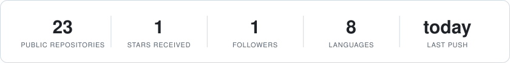
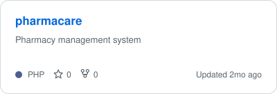
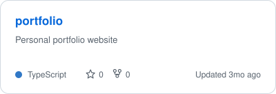
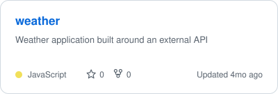
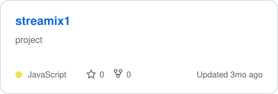
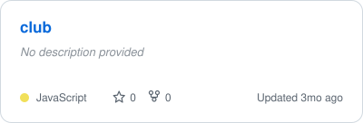
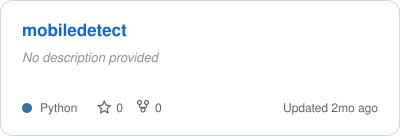
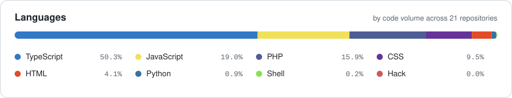
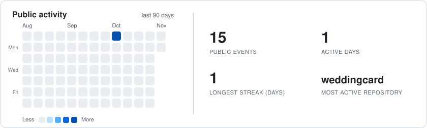

<div align="center">

<picture>
  <source media="(prefers-color-scheme: dark)" srcset="assets/header-dark.svg">
  <source media="(prefers-color-scheme: light)" srcset="assets/header-light.svg">
  
</picture>

<br/><br/>

<picture>
  <source media="(prefers-color-scheme: dark)" srcset="assets/stats-dark.svg">
  <source media="(prefers-color-scheme: light)" srcset="assets/stats-light.svg">
  
</picture>

<br/><br/>

<picture>
  <source media="(prefers-color-scheme: dark)" srcset="assets/divider-dark.svg">
  <source media="(prefers-color-scheme: light)" srcset="assets/divider-light.svg">
  
</picture>

</div>

## 👨‍💻 About Me

```text
NAME       : Alen Joseph
PRONOUNS   : He / Him
ROLE       : Full-Stack Developer
PHILOSOPHY : Simple ideas. Thoughtful code. Useful experiences.
```

I'm a full-stack developer who enjoys building for the web. Simple ideas, thoughtful code, and useful experiences are at the core of everything I build.

<div align="center">

<picture>
  <source media="(prefers-color-scheme: dark)" srcset="assets/divider-dark.svg">
  <source media="(prefers-color-scheme: light)" srcset="assets/divider-light.svg">
  
</picture>

</div>

## 📌 Featured Projects

<!--PROJECTS:START-->
<table>
<tr>
<td width="50%" valign="top"><a href="https://github.com/iam-alenjoseph/pharmacare"><picture><source media="(prefers-color-scheme: dark)" srcset="assets/card-pharmacare-dark.svg"><source media="(prefers-color-scheme: light)" srcset="assets/card-pharmacare-light.svg"></picture></a></td>
<td width="50%" valign="top"><a href="https://github.com/iam-alenjoseph/portfolio"><picture><source media="(prefers-color-scheme: dark)" srcset="assets/card-portfolio-dark.svg"><source media="(prefers-color-scheme: light)" srcset="assets/card-portfolio-light.svg"></picture></a></td>
</tr>
<tr>
<td width="50%" valign="top"><a href="https://github.com/iam-alenjoseph/weather"><picture><source media="(prefers-color-scheme: dark)" srcset="assets/card-weather-dark.svg"><source media="(prefers-color-scheme: light)" srcset="assets/card-weather-light.svg"></picture></a></td>
<td width="50%" valign="top"><a href="https://github.com/iam-alenjoseph/streamix1"><picture><source media="(prefers-color-scheme: dark)" srcset="assets/card-streamix1-dark.svg"><source media="(prefers-color-scheme: light)" srcset="assets/card-streamix1-light.svg"></picture></a></td>
</tr>
<tr>
<td width="50%" valign="top"><a href="https://github.com/iam-alenjoseph/club"><picture><source media="(prefers-color-scheme: dark)" srcset="assets/card-club-dark.svg"><source media="(prefers-color-scheme: light)" srcset="assets/card-club-light.svg"></picture></a></td>
<td width="50%" valign="top"><a href="https://github.com/iam-alenjoseph/mobiledetect"><picture><source media="(prefers-color-scheme: dark)" srcset="assets/card-mobiledetect-dark.svg"><source media="(prefers-color-scheme: light)" srcset="assets/card-mobiledetect-light.svg"></picture></a></td>
</tr>
</table>
<!--PROJECTS:END-->

<div align="center">

<picture>
  <source media="(prefers-color-scheme: dark)" srcset="assets/divider-dark.svg">
  <source media="(prefers-color-scheme: light)" srcset="assets/divider-light.svg">
  
</picture>

</div>

## 🛠️ Languages & Technologies

<div align="center">

<picture>
  <source media="(prefers-color-scheme: dark)" srcset="assets/languages-dark.svg">
  <source media="(prefers-color-scheme: light)" srcset="assets/languages-light.svg">
  
</picture>

<br/><br/>

<picture>
  <source media="(prefers-color-scheme: dark)" srcset="assets/divider-dark.svg">
  <source media="(prefers-color-scheme: light)" srcset="assets/divider-light.svg">
  
</picture>

</div>

## 📈 Activity & Streak

<div align="center">

<picture>
  <source media="(prefers-color-scheme: dark)" srcset="assets/activity-dark.svg">
  <source media="(prefers-color-scheme: light)" srcset="assets/activity-light.svg">
  
</picture>

</div>

### ⚡ Recent Activity

<!--RECENT:START-->
- Pushed to [weddingcard](https://github.com/iam-alenjoseph/weddingcard) <sub>· 28d ago</sub>
<!--RECENT:END-->

<div align="center">

<picture>
  <source media="(prefers-color-scheme: dark)" srcset="assets/divider-dark.svg">
  <source media="(prefers-color-scheme: light)" srcset="assets/divider-light.svg">
  
</picture>

</div>

## 📬 Find Me

<div align="center">

| Place | Link |
|:--:|:--:|
| **Portfolio** | [Explore my work ↗](https://iam-alenjoseph.github.io/Alen-Joseph-s-Portfolio/) |
| **GitHub** | [@iam-alenjoseph ↗](https://github.com/iam-alenjoseph) |
| **LinkedIn** | [alen-joseph-a96b2537b ↗](https://linkedin.com/in/alen-joseph-a96b2537b) |

<br/>

```text
     Every connection is a once-in-a-lifetime moment.     

                  THANK YOU FOR VISITING                  
         ========================================         
```

<br/>

<!--UPDATED:START-->
<sub>Images and activity are generated by <a href="scripts/generate.py">scripts/generate.py</a> and refreshed daily by GitHub Actions. Last run: 2026-11-02.</sub>
<!--UPDATED:END-->

</div>
